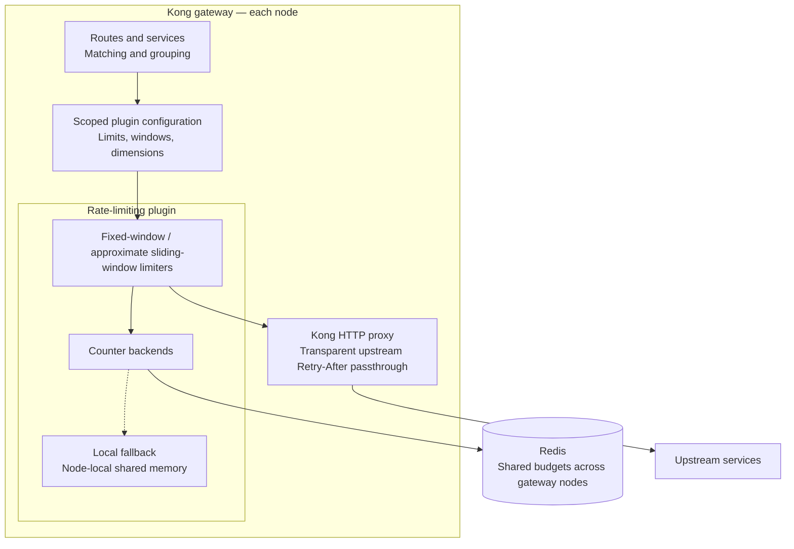

# Kong fixed and sliding-window rate limiter

## Overview

This project implements a custom rate-limiting plugin for Kong, supporting both fixed and sliding-window algorithms with Redis as the backend for distributed consistency. It aims to provide accurate rate limiting while maintaining high performance and availability in a gateway environment.

## Design for the distributed rate limiting

### Requirements
- the main stream rate limit algorithm
- support multiple dimension matching rules
- Leverage Redis as the backend for distributing consistency
- Configurable by time window and threshold
- Multiple instances should have have strong consistency through Redis


### Design Considerations

#### Environment for MVP

Since it is a MVP and POC, we should leverage current infra as mush as we could to focus the core logic of rate limit.
So use curreent Kong with a customer plugin should be a good choice for the MVP.

### Architecture for MVP

#### Architecture Overview

The MVP extends Kong with a custom rate-limiting plugin. Kong owns routing and
configuration; the plugin owns window algorithms and counter backends.



Routes and services define which traffic a plugin configuration covers. Multiple
limits belong to that configuration, and dimensions such as ClientId or path
define counter identity within its scope.

Fixed and approximate sliding windows share the counter-backend abstraction.
Redis provides shared budgets across gateway nodes with atomic per-bucket
operations; there is no transaction across all limits. The local fallback uses
independent budgets per node, with circuit-breaker recovery to Redis.

Kong proxies admitted traffic to upstream services and preserves their
`Retry-After` headers. When the plugin rejects a request itself, it returns a
`429` response with its own `Retry-After` value.

### Tradeoffs

1. Supporting the http protocol with different requirements (maybe we have more in future) is complex and not the most valuable for the MVP.
So we should leverate exsiting Kong mature capabilities for handling HTTP protocol requirements instead of implementing them ourselves.

2. Current Kong's rate limiting plugin only supports fixed window, and make a sliding window implementation should be a good enhancement for more accurate rate limiting. And this existing plugin prodvides a good baseline of performance.

3. For the consistency, the more strict consistency will lead to higher latency and potential performance trade-offs, while weaker consistency may improve performance but at the cost of potential rate limit violations in distributed scenarios.

In our scenario, as a middleware in gateway, the performance and avalibility are most critical and mandatory. So we could make a weaker consistency
for better performance once the redis MVP is validated.

4. Integration tests and baseline performance test with kong's existing rate limiting plugin should be conducted to ensure the custom plugin meets the required performance and correctness standards.

### Detail design for each component

#### Matching Rule and Dynamic Configuration

The matching rule could be covered by kong `route` or `service` definitions. So this requirement and the dynamic configuration could be handled by Kong itself, while the rate limiting logic would be implemented in the custom plugin.

#### Rate Limiting Algorithm Choice

After reading the exsiting plugin in [kong](https://github.com/Kong/kong/blob/21032122ab80c973f368f6bc539f53985e7164e8/kong/plugins/rate-limiting/policies/init.lua#L366-L439) and [treafik](https://github.com/traefik/traefik/blob/master/pkg/middlewares/ratelimiter/redis_limiter.go), kong uses fixed window and treafil uses buckets.

In [kong advanced rate limiting](https://developer.konghq.com/plugins/rate-limiting-advanced/), it suports both fixed and sliding window algorithms.

So for the MVP, we will implement a fixed window rate limiting algorithm.
Then we will implement slide window and token bucket algorithms for more accurate rate limiting.
It should be configured through the custom plugin, allowing users to specify the time window and threshold for rate limiting.

#### Distributed Consistency with Redis

Both traefik and kong rate limiting plugin use lua script to to rate limit computing inside the Redis server.
This ensures strong consistency and we could also use this way in MVP first step.
Kong plugin has async update machanism which makes performance better but may have a slightly weaker consistency.
For a gateway, performance of traffic is the core concern, so this could be adapt to our first version of plugin.

The cost of redis network and redis lua engine may impact the performance when there is high traffic.
So in plan we should optimize it with sharding or sub-windows with local cache to improve performance.

#### Fallback when redis failed

When redis is lost, we **must** have a fallback way to let the traffic works, we will switch back to local in-memory rate limiting.
This may made the rate limiting less accurate and could potentially allow some traffic to exceed the intended limits.
But it is mandatory to have this fallback to ensure that traffic continues to flow even when Redis is unavailable.

During fallback, use half-open strategy to gradually allow traffic back to Redis once it becomes available again. This helps to prevent a sudden surge of traffic that could overwhelm the Redis server and ensures a smoother transition back to the primary rate limiting mechanism.

### Implementation Plan

#### MVP Implementation

1. Follow current kong rate limiting plugin and write a redis fixed and sliding window, supporting sync mode.
2. Implement local in-memory fallback for when Redis is unavailable with the half-open strategy to gradually allow traffic back to Redis once it becomes available again.
3. Write tests to ensure the correctness and performance of the rate limiting plugin under various scenarios, including high traffic, Redis failures, and fallback situations.
4. Add integration tests and benchmark tests with kong's existing rate limiting plugin to compare performance and correctness.


#### Future plan need for a really production ready one

1. Support async mode to use weaker consistency for better performance. It depends on the performance report we get in kong's sync and async modes.
2. If the async optimization couldn't achieve the desired performance improvement, optimize the performance of the rate limiting plugin, potentially through techniques such as sharding, sub-windows, and local caching to reduce the impact of Redis network and Lua engine overhead under high traffic conditions.
We have a example could learn from, [Kong Scalable Rate Limiter](https://dream11.github.io/kong-scalable-rate-limiter/).
3. Add metrics and monitoring to track the performance and effectiveness of the rate limiting plugin, including the number of requests limited, fallback occurrences, and Redis latency. It will be great to integrate with opentelemetry for centralized observability.


## How to use and test this plugin

A standalone custom Kong plugin with fixed and approximate sliding windows,
shared Redis counters, and node-local rate limiting during Redis failures.
Three official `kong:3.9.4` containers (two workers each) use PostgreSQL for Kong
configuration and Redis 7.4 for counters. No upstream Kong checkout or custom
PostgreSQL tables are required.

## Start and test

Prerequisites: Docker Engine and Docker Compose v2. Run from this repository:

```sh
./run.sh start
curl -i -H 'X-Client-Id: alice' http://localhost:8100/window/a
curl -i -H 'X-Client-Id: alice' http://localhost:8200/window/b
./run.sh test
./run.sh stop
```

Startup installs a service-scoped demo: five requests per fixed second and an
approximate sliding limit of 30 per minute per ClientId, shared across both paths
and all three gateways. The same ClientId uses the same budget regardless of
which gateway receives the request. Another ClientId has its own budget.

The test command builds a dedicated Python test image with uv and locked pytest
dependencies, then runs Lua syntax/unit checks, Redis hash-field expiry and
concurrency checks, isolated shared-memory checks, HTTP integration scenarios,
Redis failure/recovery, and an actual gateway restart. Tests run sequentially and
leave the small demo policy installed. Do not run suites or benchmarks
concurrently against the same Compose project.

See [test cases and benchmarks](test/README.md) for scenario details, expected
results, individual commands, and benchmark report interpretation.

GitHub Actions runs the same start/test/stop commands on pushes, pull requests,
and manual dispatches. The [integration workflow](.github/workflows/integration.yml)
uses Ubuntu 24.04 and an isolated Compose project per run. Test output and
container diagnostics are uploaded as the `integration-logs` artifact for seven
days, including failed runs. No repository secrets or source Kong build are needed.

| Service | Address |
| --- | --- |
| Kong proxies | `http://localhost:8100`, `:8200`, `:8300` |
| Kong Admin APIs | `http://localhost:8101`, `:8201`, `:8301` (localhost only) |
| Redis | `127.0.0.1:6380` (internal address `redis:6379`) |
| PostgreSQL / Python echo / Go benchmark upstream | Internal Compose network only |

```text
kong/plugins/rate-limiting-sliding-window/  Plugin and implementation notes
test/                                     Python integration echo, Go benchmark server, tests, k6
.github/workflows/integration.yml          Integration CI
compose.yaml                              Three gateways, PostgreSQL, Redis, echo
run.sh                                    Start, test, benchmark, stop
Dockerfile                                Optional deployment image
```

Compose mounts plugin modules read-only. Restart all three gateways after Lua
changes because workers cache loaded modules:

```sh
docker compose restart kong1 kong2 kong3
docker compose logs -f kong1 kong2 kong3
```

The optional image adds only this plugin to the official Kong image:

```sh
docker build -t kong-rate-limiting-sliding-window:local .
```

Compose uses the official image directly and does not need this build. Its
historical project name `kong-shared-rate-limiting` is retained to reuse existing
PostgreSQL and Redis volumes. `./run.sh stop` preserves those volumes; use
`docker compose down -v` only to intentionally discard their data.

## Fixed and sliding-window plugin

`rate-limiting-sliding-window` uses Kong for route matching and policy selection.
Attach it to a Gateway Service to share budgets across that service's routes.
A route-level configuration overrides a service-level configuration of the same
plugin; put all simultaneous limits into the selected configuration.

The default service-scoped demo can also be reapplied explicitly:

```sh
docker compose run --build --rm --no-deps tests uv run --frozen --no-sync python window_configure.py
curl -i -H 'X-Client-Id: alice' http://localhost:8100/window/a
curl -i -H 'X-Client-Id: alice' http://localhost:8200/window/b
```

Both paths share five admissions per fixed second and an approximate sliding
limit of 30 per minute for each client. General service-scoped configuration:

```json
{
  "name": "rate-limiting-sliding-window",
  "config": {
    "client_id_header": "X-Client-Id",
    "redis": {"host": "redis", "port": 6379, "timeout": 150},
    "limits": [
      {"algorithm": "fixed_window", "window_ms": 1000,
       "limit": 20, "dimensions": ["ip"]},
      {"algorithm": "sliding_window", "window_ms": 60000,
       "limit": 300, "dimensions": ["client_id"]}
    ]
  }
}
```

POST this body to `/services/{id}/plugins` on the Admin API. Global, route, and
service-plus-route scopes are also supported; Consumer attachment is disabled.
There are no customer-defined rule IDs, explicit versions, or async modes.
Kong propagates changes normally, so updates are eventual rather than simultaneous.

Each limit requires its algorithm, integer `window_ms` (1–86,400,000), integer
`limit` (1–1,000,000), and dimensions. There can be 1–16 limits. Dimensions are
`ip`, `client_id`, `path`, `method`, `route`, and `service`; order is canonicalized.
Duplicate algorithm/window/dimension combinations are rejected. Path values are
normalized and exclude query strings. ClientId requires one nonempty header of
at most 256 bytes; it is caller-supplied and should come from a trusted ingress in
an actual deployment. IP uses Kong's trusted-proxy-aware PDK.

Fixed windows align with epoch boundaries and allow bursts across boundaries.
Sliding windows keep current and previous counts and estimate usage as:

```text
current + previous * (1 - elapsed_in_current_window / window_ms)
```

This is an approximation, not an exact rolling-window cap. Kong captures a
millisecond timestamp once per request and computes window boundaries and the
admission decision. Keep gateway clocks synchronized: there is no Redis TIME
lookup or server-clock correction for skew between gateways.

Redis maintains one hash per bucket. Calls for all configured limits are sent in
one pipeline; each small per-bucket Lua operation reads the current/previous
fields, increments the current field, and sets its field TTL. There is no Lua
loop over all limits and no WATCH/MULTI/EXEC transaction. Each bucket operation
is atomic; different limits are independent. All limits must allow forwarding,
but every attempt consumes their counters, including requests denied by another
limit. A later command error can leave earlier counters incremented. An ambiguous
pipeline response is never replayed; NOSCRIPT recovery retries only failed entries.

Redis hash keys are binary, 104 bytes long:

```text
"rlsw:v2:" + service UUID [16] + route UUID [16]
          + limit signature [32] + identity SHA-256 [32]
```

UUIDs use raw bytes; absent scope IDs are zero-filled. IDs come from the plugin's
configured scope, not the matched request route. The limit signature includes
algorithm/window/dimension names but excludes the threshold. Threshold updates
retain counts; changing the window, algorithm, dimensions, or scope selects new
state. Deleting/recreating a plugin at the same scope can reuse existing counts.
Hex-encode keys for inspection because they can contain zero bytes.

Hash fields are readable decimal window-start timestamps, with integer attempt
counts as values. For example, a sliding bucket may contain:

```text
1793955600000 -> 120  (previous window)
1793955660000 -> 45   (current window)
```

The per-bucket script reads both counts consistently. Redis [HPEXPIRE](https://redis.io/docs/latest/commands/hpexpire/) (millisecond
HEXPIRE, requires Redis 7.4+) expires fixed-window fields at the end of their
window and sliding fields after the following window, allowing the previous
count to contribute. Existing field TTLs are preserved, so busy buckets do not
keep old fields forever. Only the current and previous fields participate in
admission; expired historical fields disappear automatically. Empty hashes are
removed by Redis. Local fallback mirrors these window counters in shared memory.

The v2 hash layout replaces the original v1 hash of start/current/previous/last
metadata. Rollout starts fresh v2 budgets; existing v1 data is left to expire.

Redis operation failures activate full independent budgets on each node, shared
across that node's workers. A node-shared breaker starts with 250 ms cooldown,
backs off failed probes up to four seconds, and allows one probe at a time.
Recovery ramps through 10%, 25%, 50%, and 100% Redis traffic at one-second stages.
Local consumption is not merged into Redis. Global quota guarantees do not apply
during outages/recovery, configuration propagation, restarts, or Redis state loss.
Connection, authentication, script, and Redis counter errors all activate local
fallback. Return 503 only if local enforcement also fails (for example, shared
memory exhaustion); Redis errors alone do not make requests unavailable.

Responses expose `X-Kong-Instance`, `X-RateLimit-Mode`,
`X-RateLimit-Time-Ms`, and `X-RateLimit-Remaining` (minimum whole remaining
admissions among configured limits). Local throttling returns 429, JSON,
`Cache-Control: no-store`, and a rounded-up `Retry-After`. Upstream errors and
Retry-After pass through; admitted requests are not refunded.

`./run.sh test` runs deterministic Lua unit tests, isolated real shared-memory
checks (including exhaustion without eviction), direct Redis checks, concurrent
gateway tests, and restart checks sequentially. The HTTP suite removes only its
own temporary services/routes/plugins. Never run suites concurrently against this
Compose project. Individual tests can be run alone:

```sh
docker compose exec -T kong1 /usr/local/openresty/bin/resty /test/window_unit.lua
docker compose exec -T kong1 /usr/local/openresty/bin/resty /test/window_redis.lua
docker compose run --build --rm --no-deps tests uv run --frozen --no-sync pytest -v -m "not restart"
```

The plugin requires a `sliding_ratelimit` shared dictionary (Compose allocates
16 MB) and Kong's lock dictionary. Lua modules are mounted read-only: restart all
three gateways after edits. No custom DAO, migration, metrics exporter, or
PostgreSQL counter backend is included. Async syncing, exact timestamp logs,
Redis Cluster, and optimization work are deferred. See
[kong/plugins/rate-limiting-sliding-window/IMPLEMENTATION.md](kong/plugins/rate-limiting-sliding-window/IMPLEMENTATION.md)
for implementation decisions.

## Query Redis from the host

Redis is published on `127.0.0.1:6380`; port 6379 was already occupied on the
host. Kong still connects to `redis:6379` inside Compose. The existing dedicated
Redis volume is retained when applying this mapping.

```sh
redis-cli -h 127.0.0.1 -p 6380 PING
redis-cli -h 127.0.0.1 -p 6380
```

Inside redis-cli, use `INFO keyspace` and
`SCAN 0 MATCH rlsw:v2:* COUNT 10` to inspect the window plugin's counters.
Use `HGETALL "<escaped-key>"` to inspect its timestamp fields and counts and
`HPTTL "<escaped-key>" FIELDS 1 <window-start>` to inspect a field's remaining TTL.
Keys contain binary UUIDs/digests; the interactive client displays escaped bytes.

To use another host port, set `REDIS_HOST_PORT` when starting Compose, for example
`REDIS_HOST_PORT=6381 ./run.sh start`. The binding is localhost-only; from another
machine, forward it with SSH, for example
`ssh -L 6380:127.0.0.1:6380 user@docker-host`, then connect to local port 6380.

## Compose benchmark with DNS round robin

All three gateways share the Compose network alias `gateway`. From another
container, `gateway:8000` resolves to the three gateway IPs. The `benchmark`
profile supplies a pinned `grafana/k6:1.3.0` client; it does not start as part of
normal `up` or the test suite. No extra load balancer is involved.

For a fresh checkout, start the stack and benchmark its default demo:

```sh
./run.sh start
./run.sh benchmark --vus 20 --duration 30s
```

Both benchmark commands build a separate Go HTTP upstream. It returns constant
512-byte JSON over HTTP/1.1 without per-request logging; host Go is not required.
The Python echo server remains the upstream for normal demos and integration tests.

The standalone benchmark installs its own service-scoped demo at `/benchmark/a`
and `/benchmark/b`, leaving `/window/*` and user policies intact. It targets
`http://gateway:8000/benchmark/a`, uses a fresh shared ClientId per run, and reports total
requests/second, 200 admissions, 429 throttles, unexpected responses, Redis/local
mode, latency percentiles, connection time, and per-gateway request counts.
429 is an expected rate-limit decision rather than a transport failure. The run
fails if any gateway receives no traffic, any request is unexpected, diagnostic
headers are missing, or any request uses local fallback.

k6 selects `roundRobin` from a cached IPv4 address set (`ttl: inf`). Caching keeps
Docker's shuffled DNS response order from changing the set during the run;
restart the benchmark after recreating gateway containers. DNS selection occurs
on new connections. By default connection reuse is disabled so requests rotate
across addresses. This includes TCP connection overhead; `latency_ms` excludes
connection setup while `iteration_ms` includes it. Keeping connections alive
changes the distribution to new connections rather than individual requests.
See [k6 DNS and connection options](https://grafana.com/docs/k6/latest/using-k6/k6-options/reference/#dns).

Configuration examples:

```sh
# Reuse connections and give each virtual user a separate client budget.
BENCH_KEEPALIVE=true BENCH_CLIENT_MODE=per-vu \
  ./run.sh benchmark --vus 30 --duration 30s

# Exercise admissions with a new ClientId/counter for each request.
BENCH_CLIENT_MODE=unique ./run.sh benchmark --vus 5 --duration 10s

# Target another configured route through the same DNS alias.
BENCH_URL=http://gateway:8000/my-route \
  ./run.sh benchmark --vus 20 --duration 30s

# Save the final JSON report; --quiet suppresses k6's banner/progress.
./run.sh benchmark --quiet --vus 20 --duration 30s > /tmp/kong-benchmark.json

# Run k6 directly after ./run.sh benchmark has started/configured its Go demo.
docker compose run --rm --no-deps benchmark run --vus 20 --duration 30s /test/benchmark.js
```

To compare the bundled Kong Redis limiter against our fixed and sliding windows:

```sh
./run.sh benchmark-compare --vus 20 --duration 15 --warmup 3 --repeats 3 --keepalive \
  --output /tmp/kong-rate-limit-comparison
```

This uses temporary policies, separate admitted/throttled workloads, and rotating
serial trials. It requires host Python 3 and writes raw JSON plus a Markdown
comparison report. A separate [PR benchmark workflow](.github/workflows/benchmark.yml)
runs Kong sync/async and both custom windows automatically with explicit CPU/memory
caps, uploads raw reports, and updates the PR conversation. Results are not
committed. See the [comparison methodology](test/README.md#compare-against-kongs-bundled-plugin).

Environment defaults: `BENCH_VUS=20`, `BENCH_DURATION=30s`,
`BENCH_KEEPALIVE=false`, `BENCH_CLIENT_MODE=shared`. `BENCH_CLIENT_ID` optionally
sets a stable client identity. Client modes are `shared`, `per-vu`, and `unique`;
unique mode creates many counters and measures the admission path rather than
shared-client throttling. CLI `--vus`/`--duration` override environment defaults.

The demo has small quotas, so shared-client runs predominantly measure the 429
path. For admission throughput, use unique clients or configure larger limits on
your target policy. Results include all applicable plugins, the Go backend for admitted requests,
and the resources shared by containers on this host. They are not isolated
measurements of the new plugin's execution time. Do not run benchmarks alongside
integration suites against this Compose project.
