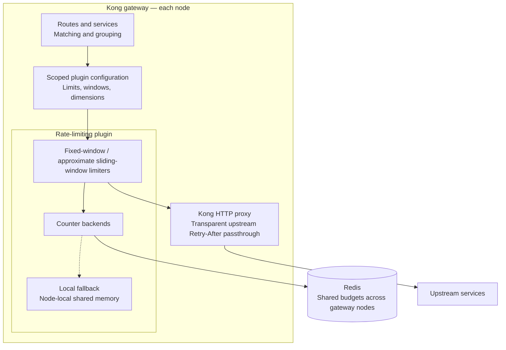

# Kong fixed and sliding-window rate limiter

## Overview

This project implements a custom Kong rate-limiting plugin with fixed and approximate sliding windows. It supports configurable windows, thresholds, and dimensions such as Path, Client ID, and IP.

Redis provides shared counters across gateway nodes using atomic per-bucket operations. Operations across multiple limits are independent. Consistent enforcement assumes synchronized gateway clocks and converged plugin configurations.

During Redis failures, this MVP deliberately prioritizes availability by switching to independent node-local budgets. Local consumption is not reconciled with Redis, so a strict global quota is not guaranteed during outages or recovery.

## Design for distributed rate limiting

### Requirements

- Implement a mainstream rate-limiting algorithm.
- Support Path, Client ID, and IP dimensions, including combinations.
- Use Redis to coordinate a shared quota pool across at least three Kong nodes.
- Return HTTP 429 with `Retry-After` when a limit is exceeded.
- Support dynamic configuration of dimensions, windows, and thresholds.

The assignment targets consistent enforcement of the shared quota. This MVP uses atomic per-bucket Redis operations during normal operation, with the deliberate local-fallback exception described above.

### Design Considerations

#### Environment for MVP

Since this is an MVP and proof of concept, we should reuse existing infrastructure as much as possible to focus on the core rate-limiting logic.
Using Kong with a custom plugin is therefore a good choice for the MVP.

### Architecture for MVP

#### Architecture Overview

The MVP extends Kong with a custom rate-limiting plugin. Kong owns routing and
configuration; the plugin owns window algorithms and counter backends.



Routes and services define which traffic a plugin configuration covers. Multiple
limits belong to that configuration, and dimensions such as ClientId or path
define counter identity within its scope.

Fixed and approximate sliding windows share the counter-backend abstraction.
Redis provides shared budgets across gateway nodes with atomic per-bucket
operations; there is no transaction across all limits. The local fallback uses
independent budgets per node, with circuit-breaker recovery to Redis.

Kong proxies admitted traffic to upstream services and preserves their
`Retry-After` headers. When the plugin rejects a request itself, it returns a
`429` response with its own `Retry-After` value.

### Tradeoffs

1. Supporting HTTP with different requirements (and possibly more in the future) is complex and is not the most valuable work for the MVP.
We should therefore use Kong's existing, mature HTTP capabilities instead of implementing them ourselves.

2. Kong's current rate-limiting plugin only supports fixed windows, so adding a sliding-window implementation would be a useful enhancement for more accurate rate limiting. The existing plugin also provides a good performance baseline.

3. Stricter consistency can increase latency and introduce performance tradeoffs, while weaker consistency may improve performance at the cost of potential rate-limit violations in distributed scenarios.

In our gateway middleware scenario, performance and availability are the most critical and mandatory goals. We could therefore accept weaker consistency
for better performance once the Redis MVP is validated.

4. Integration tests and baseline performance tests against Kong's existing rate-limiting plugin should be conducted to ensure the custom plugin meets the required performance and correctness standards.

### Detailed design for each component

#### Matching Rule and Dynamic Configuration

Matching rules can be covered by Kong's `route` or `service` definitions. This requirement and dynamic configuration can therefore be handled by Kong itself, while rate-limiting logic is implemented in the custom plugin.

#### Rate Limiting Algorithm Choice

After reviewing the existing [Kong plugin](https://github.com/Kong/kong/blob/21032122ab80c973f368f6bc539f53985e7164e8/kong/plugins/rate-limiting/policies/init.lua#L366-L439) and [Traefik limiter](https://github.com/traefik/traefik/blob/master/pkg/middlewares/ratelimiter/redis_limiter.go), we found that Kong uses fixed windows and Traefik uses buckets.

[Kong Advanced Rate Limiting](https://developer.konghq.com/plugins/rate-limiting-advanced/) supports both fixed and sliding-window algorithms.

The MVP implements both fixed and approximate sliding windows. Fixed windows provide a direct baseline against Kong's bundled limiter. Sliding windows estimate usage from the current and previous windows to reduce boundary effects; they do not enforce an exact rolling-window quota.

Each limit is configured through the custom plugin, including its algorithm, window duration, threshold, and counter dimensions.

##### Sliding-window pros and cons

The two-counter approximation is inspired by [Cloudflare's sliding-window description](https://blog.cloudflare.com/counting-things-a-lot-of-different-things/#sliding-windows-to-the-rescue): current usage plus a decreasing weight of the previous window's usage.

**Pros**

- Previous-window memory reduces the abrupt budget reset and boundary bursts of fixed windows.
- Only two counters participate in each decision, avoiding a per-request timestamp log and keeping calculation work constant per limit.

**Cons**

- Weighting assumes traffic was spread uniformly across the previous window. It can overestimate or underestimate exact rolling usage.
- Compared with fixed windows, it reads an additional counter and performs a weighted calculation.
- It still allows bursts within the available budget; it does not queue requests or maintain a constant upstream rate.

See [PR #6](https://github.com/LindaSummer/kong-rate-limit-plugin/pull/6) for implementation tradeoffs, traffic illustrations, measured results, and reproduction details.

#### Distributed Consistency with Redis

The design draws on Kong's Redis policy and Traefik's Redis limiter: Redis-side atomic operations allow multiple gateway nodes to coordinate shared counters. Kong's synchronous and asynchronous modes also provide a reference for evaluating the tradeoff between consistency and throughput.

This MVP starts with synchronous accounting to establish a correctness and performance baseline. It pipelines operations across configured limits, with a small atomic Lua operation per bucket. Window calculations and admission decisions run in Kong. There is no transaction across limits, and denied attempts still consume counters.

Window boundaries use gateway timestamps, so synchronized clocks are required. Clock skew can make nodes select different windows near boundaries. Configuration updates also propagate eventually.

Redis round trips and script execution introduce overhead. Kong's async baseline helps evaluate whether asynchronous accounting is a worthwhile next step, while profiling can identify opportunities in our implementation.

#### Fallback when Redis fails

When Redis accounting fails, the plugin switches to node-local enforcement. This is an intentional availability choice: workers on one node share a local budget, but different nodes enforce independent budgets.

A circuit breaker limits recovery probes and gradually restores Redis traffic. Local consumption is not merged into Redis, so the configured global quota can be exceeded during outages and recovery.

Redis errors alone do not make requests unavailable. Local enforcement can still reject requests with HTTP 429; the plugin returns HTTP 503 if local enforcement also fails.

### Implementation Plan

#### MVP Implementation

1. Implemented fixed and approximate sliding windows with synchronous Redis accounting.
2. Implemented node-local fallback with circuit-breaker probes and gradual recovery.
3. Added correctness tests covering algorithms, shared budgets, dynamic configuration, Redis failures, and gateway restarts.
4. Added benchmarks against Kong's bundled synchronous and asynchronous Redis limiter, plus direct-upstream and plugin-free controls.


#### Future work for production readiness

1. Profile the synchronous request path, including circuit-breaker lock contention and JSON state reads/writes. Investigate reducing unchanged-state writes while preserving failure fencing and the single-probe guarantee. These are optimization candidates; the current benchmarks do not isolate their individual costs.
2. Support async mode with weaker consistency for better performance. This depends on the benchmark results for Kong's sync and async modes.
3. If async optimization does not achieve the desired performance improvement, optimize the rate-limiting plugin through techniques such as sharding, sub-windows, and local caching to reduce Redis network and Lua engine overhead under high traffic conditions.
   We can learn from an example: [Kong Scalable Rate Limiter](https://dream11.github.io/kong-scalable-rate-limiter/).
4. Add metrics and monitoring to track the performance and effectiveness of the rate-limiting plugin, including the number of requests limited, fallback occurrences, and Redis latency. Integrating with OpenTelemetry would support centralized observability.
5. Add a configuration option to include or exclude rejected requests from usage counters, retaining all-attempt counting as the default. Compare retry behavior and recovery for both policies, and keep per-bucket admission and conditional increments atomic when rejected attempts are excluded. Evaluate adapting [Cloudflare's approach](https://blog.cloudflare.com/counting-things-a-lot-of-different-things/#sliding-windows-to-the-rescue), which combines asynchronous counting with a cached mitigation decision and an expiry time; this mitigation cache is a separate design choice from whether rejected requests consume counters.

##### Benchmark comparison with Kong

Benchmark reports are available for [my local host](https://github.com/LindaSummer/kong-rate-limit-plugin/pull/2#issuecomment-6708567152) and [GitHub Actions](https://github.com/LindaSummer/kong-rate-limit-plugin/pull/2#issuecomment-6709115520).

From the benchmark report, I find that performance in async mode is generally better than in sync mode, especially under high traffic conditions. However, the exact improvement depends on the specific workload and configuration.

Here is the environment and setup for the benchmark:

- Kong 3.9.4, Redis 7.4, k6 1.3.0; three Kong nodes with two workers each.
- Docker host: 32 logical CPUs, 123.4 GiB RAM, x86_64.

In the first version, I reused the Python integration test setup for benchmarking, but sync and async modes showed little performance difference under the tested scenarios.

| Workload | Plugin | Median req/s (min–max) | vs Kong sync | Median p95 ms | Median p99 ms | Measured 200 / 429 |
| --- | --- | ---: | ---: | ---: | ---: | ---: |
| admitted | Direct echo backend | 14,384 (14,359–14,401) | 1.56× | 2.844 | 3.909 | 431,487 / 0 |
| admitted | Kong without plugins | 9,830 (9,788–9,833) | 1.06× | 4.159 | 5.670 | 294,551 / 0 |
| admitted | Kong sync | 9,240 (9,157–9,277) | 1.00× | 4.288 | 5.778 | 276,778 / 0 |
| admitted | Kong async | 9,641 (9,600–9,702) | 1.04× | 4.240 | 5.795 | 289,480 / 0 |
| admitted | Custom fixed_window | 9,253 (9,205–9,316) | 1.00× | 4.290 | 5.834 | 277,781 / 0 |
| admitted | Custom sliding_window | 9,258 (9,219–9,282) | 1.00× | 4.308 | 5.816 | 277,640 / 0 |
| throttled | Kong sync | 64,850 (64,585–64,940) | 1.00× | 0.512 | 1.035 | 0 / 1,943,962 |
| throttled | Kong async | 85,918 (85,762–86,517) | 1.32× | 0.343 | 0.676 | 0 / 2,582,635 |
| throttled | Custom fixed_window | 38,700 (38,298–39,194) | 0.60× | 1.458 | 2.946 | 0 / 1,162,166 |
| throttled | Custom sliding_window | 39,312 (38,487–39,406) | 0.61× | 1.419 | 2.949 | 0 / 1,172,392 |

Then I changed to a Go HTTP server, and performance improved significantly.
The faster upstream makes the performance difference between synchronous and asynchronous accounting more visible.

| Workload | Plugin | Median req/s (min–max) | vs Kong sync | Median p95 ms | Median p99 ms | Measured 200 / 429 |
| --- | --- | ---: | ---: | ---: | ---: | ---: |
| admitted | Direct Go backend | 95,889 (94,606–97,007) | 3.08× | 0.185 | 0.524 | 2,876,855 / 0 |
| admitted | Kong without plugins | 62,717 (62,448–62,740) | 2.02× | 0.378 | 0.831 | 1,879,126 / 0 |
| admitted | Kong sync | 31,095 (31,074–31,809) | 1.00× | 1.225 | 2.214 | 939,919 / 0 |
| admitted | Kong async | 56,393 (56,375–56,565) | 1.81× | 0.539 | 1.107 | 1,693,445 / 0 |
| admitted | Custom fixed_window | 32,324 (32,106–33,599) | 1.04× | 1.579 | 3.105 | 980,445 / 0 |
| admitted | Custom sliding_window | 32,987 (32,074–33,244) | 1.06× | 1.572 | 3.055 | 983,282 / 0 |
| throttled | Kong sync | 64,696 (64,335–65,106) | 1.00× | 0.516 | 1.042 | 0 / 1,941,525 |
| throttled | Kong async | 85,383 (85,151–85,761) | 1.32× | 0.346 | 0.676 | 0 / 2,563,319 |
| throttled | Custom fixed_window | 37,330 (37,062–38,026) | 0.58× | 1.526 | 3.029 | 0 / 1,124,631 |
| throttled | Custom sliding_window | 38,421 (37,856–38,526) | 0.59× | 1.483 | 2.983 | 0 / 1,148,274 |

This makes the asynchronous optimization work and significantly improves request throughput compared to the synchronous approach, especially when Redis I/O becomes the major bottleneck.

So async accounting is the next performance optimization to evaluate, with explicit bounds on overshoot and counter loss.


## How to use and test this plugin

__This section was prepared primarily with assistance from Codex.__

A standalone custom Kong plugin with fixed and approximate sliding windows,
shared Redis counters, and node-local rate limiting during Redis failures.
Three official `kong:3.9.4` containers (two workers each) use PostgreSQL for Kong
configuration and Redis 7.4 for counters. No upstream Kong checkout or custom
PostgreSQL tables are required.

### Start and test

Prerequisites: Docker Engine and Docker Compose v2. Run from this repository:

```sh
./run.sh start
docker compose run --rm --no-deps -T tests uv run --frozen --no-sync python - <<'PYTHON'
from common import http
for url in ("http://kong1:8000/window/a", "http://kong2:8000/window/b"):
    print(http(url, headers={"X-Client-Id": "alice"}))
PYTHON
./run.sh test
./run.sh stop
```

Startup installs a service-scoped demo: five requests per fixed second and an
approximate sliding limit of 30 per minute per ClientId, shared across both paths
and all three gateways. The same ClientId uses the same budget regardless of
which gateway receives the request. Another ClientId has its own budget.

The test command builds a dedicated Python test image with uv and locked pytest
dependencies, then runs Lua syntax/unit checks, Redis hash-field expiry and
concurrency checks, isolated shared-memory checks, HTTP integration scenarios,
Redis failure/recovery, and an actual gateway restart. Tests run sequentially and
leave the small demo policy installed. Do not run suites or benchmarks
concurrently against the same Compose project.

See [test cases and benchmarks](test/README.md) for scenario details, expected
results, individual commands, and benchmark report interpretation.

GitHub Actions runs the same start/test/stop commands on pushes, pull requests,
and manual dispatches. The [integration workflow](.github/workflows/integration.yml)
uses Ubuntu 24.04 and an isolated Compose project per run. Test output and
container diagnostics are uploaded as the `integration-logs` artifact for seven
days, including failed runs. No repository secrets or source Kong build are needed.

All services are internal to the Compose network; no host ports are published.
Use the tests container for proxy/Admin API requests and `docker compose exec`
for Redis inspection. Separate Compose projects can run without host-port conflicts.

| Service | Internal address |
| --- | --- |
| Kong proxies | `http://kong1:8000`, `http://kong2:8000`, `http://kong3:8000` |
| Kong Admin APIs | `http://kong1:8001`, `http://kong2:8001`, `http://kong3:8001` |
| Redis | `redis:6379` |
| PostgreSQL / Python echo / Go benchmark upstream | Internal Compose network only |

These DNS names resolve inside the Compose network. For example, list Kong
services through the internal Admin API after `./run.sh start`:

```sh
docker compose run --rm --no-deps -T tests uv run --frozen --no-sync python - <<'PYTHON'
from common import admin
for service in admin("/services")["data"]:
    print(service["id"], service.get("name"))
PYTHON
```

```text
kong/plugins/rate-limiting-sliding-window/  Plugin and implementation notes
test/                                     Python integration echo, Go benchmark server, tests, k6
.github/workflows/integration.yml          Integration CI
compose.yaml                              Three gateways, PostgreSQL, Redis, echo
run.sh                                    Start, test, benchmark, stop
Dockerfile                                Optional deployment image
```

Compose mounts plugin modules read-only. Restart all three gateways after Lua
changes because workers cache loaded modules:

```sh
docker compose restart kong1 kong2 kong3
docker compose logs -f kong1 kong2 kong3
```

The optional image adds only this plugin to the official Kong image:

```sh
docker build -t kong-rate-limiting-sliding-window:local .
```

Compose uses the official image directly and does not need this build. Its
historical project name `kong-shared-rate-limiting` is retained to reuse existing
PostgreSQL and Redis volumes. `./run.sh stop` preserves those volumes; use
`docker compose down -v` only to intentionally discard their data.

### Run a separate environment

Set a unique Compose project name to create separate containers, networks, and
PostgreSQL/Redis volumes. No host-port overrides are required:

```sh
(
  export COMPOSE_PROJECT_NAME=kong-isolated-test
  ./run.sh start
  ./run.sh test
  ./run.sh stop
)
```

Use the same project name for every command that accesses that environment,
including `docker compose exec redis redis-cli`. The subshell above keeps the
setting local to that example. Stopping it preserves its own volumes; the
default demo's containers and data belong to a different project.

Use the source Compose files with the project name set before configuration is
resolved. Exported `docker compose config` output contains explicit resource
names; changing only its project name does not rename those networks or volumes.
For an isolated run with CI resource caps, see
[the benchmark environment instructions](test/README.md#automatic-pr-benchmark-and-resource-settings).

### Fixed and sliding-window plugin

`rate-limiting-sliding-window` uses Kong for route matching and policy selection.
Attach it to a Gateway Service to share budgets across that service's routes.
A route-level configuration overrides a service-level configuration of the same
plugin; put all simultaneous limits into the selected configuration.

The default service-scoped demo can also be reapplied explicitly:

```sh
docker compose run --build --rm --no-deps tests uv run --frozen --no-sync python window_configure.py
```

Send requests from the tests container as shown in [Start and test](#start-and-test).

Both paths share five admissions per fixed second and an approximate sliding
limit of 30 per minute for each client. General service-scoped configuration:

```json
{
  "name": "rate-limiting-sliding-window",
  "config": {
    "client_id_header": "X-Client-Id",
    "redis": {"host": "redis", "port": 6379, "timeout": 150},
    "limits": [
      {"algorithm": "fixed_window", "window_ms": 1000,
       "limit": 20, "dimensions": ["ip"]},
      {"algorithm": "sliding_window", "window_ms": 60000,
       "limit": 300, "dimensions": ["client_id"]}
    ]
  }
}
```

POST this body to `/services/{id}/plugins` on the Admin API. Global, route, and
service-plus-route scopes are also supported; Consumer attachment is disabled.
There are no customer-defined rule IDs, explicit versions, or async modes.
Kong propagates changes normally, so updates are eventual rather than simultaneous.

Each limit requires its algorithm, integer `window_ms` (1–86,400,000), integer
`limit` (1–1,000,000), and dimensions. There can be 1–16 limits. Dimensions are
`ip`, `client_id`, `path`, `method`, `route`, and `service`; order is canonicalized.
Duplicate algorithm/window/dimension combinations are rejected. Path values are
normalized and exclude query strings. ClientId requires one nonempty header of
at most 256 bytes; it is caller-supplied and should come from a trusted ingress in
an actual deployment. IP uses Kong's trusted-proxy-aware PDK.

Fixed windows align with epoch boundaries and allow bursts across boundaries.
Sliding windows keep current and previous counts and estimate usage as:

```text
current + previous * (1 - elapsed_in_current_window / window_ms)
```

This is an approximation, not an exact rolling-window cap. Kong captures a
millisecond timestamp once per request and computes window boundaries and the
admission decision. Keep gateway clocks synchronized: there is no Redis TIME
lookup or server-clock correction for skew between gateways.

Redis maintains one hash per bucket. Calls for all configured limits are sent in
one pipeline; each small per-bucket Lua operation reads the current/previous
fields, increments the current field, and sets its field TTL. There is no Lua
loop over all limits and no WATCH/MULTI/EXEC transaction. Each bucket operation
is atomic; different limits are independent. All limits must allow forwarding,
but every attempt consumes their counters, including requests denied by another
limit. A later command error can leave earlier counters incremented. An ambiguous
pipeline response is never replayed; NOSCRIPT recovery retries only failed entries.

Redis hash keys are binary, 104 bytes long:

```text
"rlsw:v2:" + service UUID [16] + route UUID [16]
          + limit signature [32] + identity SHA-256 [32]
```

UUIDs use raw bytes; absent scope IDs are zero-filled. IDs come from the plugin's
configured scope, not the matched request route. The limit signature includes
algorithm/window/dimension names but excludes the threshold. Threshold updates
retain counts; changing the window, algorithm, dimensions, or scope selects new
state. Deleting/recreating a plugin at the same scope can reuse existing counts.
Hex-encode keys for inspection because they can contain zero bytes.

Hash fields are readable decimal window-start timestamps, with integer attempt
counts as values. For example, a sliding bucket may contain:

```text
1793955600000 -> 120  (previous window)
1793955660000 -> 45   (current window)
```

The per-bucket script reads both counts consistently. Redis [HPEXPIRE](https://redis.io/docs/latest/commands/hpexpire/) (millisecond
HEXPIRE, requires Redis 7.4+) expires fixed-window fields at the end of their
window and sliding fields after the following window, allowing the previous
count to contribute. Existing field TTLs are preserved, so busy buckets do not
keep old fields forever. Only the current and previous fields participate in
admission; expired historical fields disappear automatically. Empty hashes are
removed by Redis. Local fallback mirrors these window counters in shared memory.

The v2 hash layout replaces the original v1 hash of start/current/previous/last
metadata. Rollout starts fresh v2 budgets; existing v1 data is left to expire.

Redis operation failures activate full independent budgets on each node, shared
across that node's workers. A node-shared breaker starts with 250 ms cooldown,
backs off failed probes up to four seconds, and allows one probe at a time.
Recovery ramps through 10%, 25%, 50%, and 100% Redis traffic at one-second stages.
Local consumption is not merged into Redis. Global quota guarantees do not apply
during outages/recovery, configuration propagation, restarts, or Redis state loss.
Connection, authentication, script, and Redis counter errors all activate local
fallback. Return 503 only if local enforcement also fails (for example, shared
memory exhaustion); Redis errors alone do not make requests unavailable.

Responses expose `X-Kong-Instance`, `X-RateLimit-Mode`,
`X-RateLimit-Time-Ms`, and `X-RateLimit-Remaining` (minimum whole remaining
admissions among configured limits). Local throttling returns 429, JSON,
`Cache-Control: no-store`, and a rounded-up `Retry-After`. Upstream errors and
Retry-After pass through; admitted requests are not refunded.

`./run.sh test` runs deterministic Lua unit tests, isolated real shared-memory
checks (including exhaustion without eviction), direct Redis checks, concurrent
gateway tests, and restart checks sequentially. The HTTP suite removes only its
own temporary services/routes/plugins. Never run suites concurrently against this
Compose project. Individual tests can be run alone:

```sh
docker compose exec -T kong1 /usr/local/openresty/bin/resty /test/window_unit.lua
docker compose exec -T kong1 /usr/local/openresty/bin/resty /test/window_redis.lua
docker compose run --build --rm --no-deps tests uv run --frozen --no-sync pytest -v -m "not restart"
```

The plugin requires a `sliding_ratelimit` shared dictionary (Compose allocates
16 MB) and Kong's lock dictionary. Lua modules are mounted read-only: restart all
three gateways after edits. No custom DAO, migration, metrics exporter, or
PostgreSQL counter backend is included. Async syncing, exact timestamp logs,
Redis Cluster, and optimization work are deferred.

### Query Redis

Run Redis CLI inside its container; no host installation or port mapping is needed.
Kong and tests connect to `redis:6379` on the Compose network.

```sh
docker compose exec redis redis-cli PING
docker compose exec redis redis-cli
```

Inside redis-cli, use `INFO keyspace` and
`SCAN 0 MATCH rlsw:v2:* COUNT 10` to inspect the window plugin's counters.
Use `HGETALL "<escaped-key>"` to inspect its timestamp fields and counts and
`HPTTL "<escaped-key>" FIELDS 1 <window-start>` to inspect a field's remaining TTL.
Keys contain binary UUIDs/digests; the interactive client displays escaped bytes.

### Compose benchmark with DNS round robin

All three gateways share the Compose network alias `gateway`. From another
container, `gateway:8000` resolves to the three gateway IPs. The `benchmark`
profile supplies a pinned `grafana/k6:1.3.0` client; it does not start as part of
normal `up` or the test suite. No extra load balancer is involved.

For a fresh checkout, start the stack and benchmark its default demo:

```sh
./run.sh start
./run.sh benchmark --vus 20 --duration 30s
```

Both benchmark commands build a separate Go HTTP upstream. It returns constant
512-byte JSON over HTTP/1.1 without per-request logging; host Go is not required.
The Python echo server remains the upstream for normal demos and integration tests.

The standalone benchmark installs its own service-scoped demo at `/benchmark/a`
and `/benchmark/b`, leaving `/window/*` and user policies intact. It targets
`http://gateway:8000/benchmark/a`, uses a fresh shared ClientId per run, and reports total
requests/second, 200 admissions, 429 throttles, unexpected responses, Redis/local
mode, latency percentiles, connection time, and per-gateway request counts.
429 is an expected rate-limit decision rather than a transport failure. The run
fails if any gateway receives no traffic, any request is unexpected, diagnostic
headers are missing, or any request uses local fallback.

k6 selects `roundRobin` from a cached IPv4 address set (`ttl: inf`). Caching keeps
Docker's shuffled DNS response order from changing the set during the run;
restart the benchmark after recreating gateway containers. DNS selection occurs
on new connections. By default connection reuse is disabled so requests rotate
across addresses. This includes TCP connection overhead; `latency_ms` excludes
connection setup while `iteration_ms` includes it. Keeping connections alive
changes the distribution to new connections rather than individual requests.
See [k6 DNS and connection options](https://grafana.com/docs/k6/latest/using-k6/k6-options/reference/#dns).

Configuration examples:

```sh
# Reuse connections and give each virtual user a separate client budget.
BENCH_KEEPALIVE=true BENCH_CLIENT_MODE=per-vu \
  ./run.sh benchmark --vus 30 --duration 30s

# Exercise admissions with a new ClientId/counter for each request.
BENCH_CLIENT_MODE=unique ./run.sh benchmark --vus 5 --duration 10s

# Target another configured route through the same DNS alias.
BENCH_URL=http://gateway:8000/my-route \
  ./run.sh benchmark --vus 20 --duration 30s

# Save the final JSON report; --quiet suppresses k6's banner/progress.
./run.sh benchmark --quiet --vus 20 --duration 30s > /tmp/kong-benchmark.json

# Run k6 directly after ./run.sh benchmark has started/configured its Go demo.
docker compose run --rm --no-deps benchmark run --vus 20 --duration 30s /test/benchmark.js
```

To compare the bundled Kong Redis limiter against our fixed and sliding windows:

```sh
./run.sh benchmark-compare --vus 20 --duration 15 --warmup 3 --repeats 3 --keepalive \
  --output /tmp/kong-rate-limit-comparison
```

This uses temporary policies, separate admitted/throttled workloads, and rotating
serial trials. It requires host Python 3 and writes raw JSON plus a Markdown
comparison report. A separate [PR benchmark workflow](.github/workflows/benchmark.yml)
runs Kong sync/async and both custom windows automatically with explicit CPU/memory
caps, uploads raw reports, and updates the PR conversation. Results are not
committed. See the [comparison methodology](test/README.md#compare-against-kongs-bundled-plugin).

Environment defaults: `BENCH_VUS=20`, `BENCH_DURATION=30s`,
`BENCH_KEEPALIVE=false`, `BENCH_CLIENT_MODE=shared`. `BENCH_CLIENT_ID` optionally
sets a stable client identity. Client modes are `shared`, `per-vu`, and `unique`;
unique mode creates many counters and measures the admission path rather than
shared-client throttling. CLI `--vus`/`--duration` override environment defaults.

The demo has small quotas, so shared-client runs predominantly measure the 429
path. For admission throughput, use unique clients or configure larger limits on
your target policy. Results include all applicable plugins, the Go backend for admitted requests,
and the resources shared by containers on this host. They are not isolated
measurements of the new plugin's execution time. Do not run benchmarks alongside
integration suites against this Compose project.
