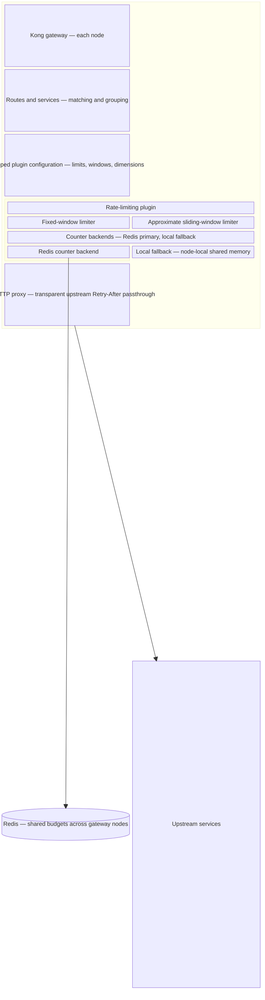

# Design for the distributed rate limiting

Implementation status: the committed MVP is `rate-limiting-sliding-window`.
Fixed and approximate sliding windows, pipelined Redis hash counters with
hash-field expiry, and local fallback are implemented. Async usage caching,
token buckets, and metrics remain future work. The sections below describe the
original proposal; see [the implementation notes](kong/plugins/rate-limiting-sliding-window/IMPLEMENTATION.md)
for the current behavior and tradeoffs.

## Requirements
- the main stream rate limit algorithm
- support multiple dimension matching rules
- Leverage Redis as the backend for distributing consistency
- Configurable by time window and threashold
- Multiple instances should have have strong consistency through Redis

## Design Considerations

### The environment for MVP

Since it is a MVP and POC, we should leverage current infra as mush as we could to focus the core logic of rate limit.
So use curreent Kong with a customer plugin should be a good choice for the MVP.

## Architecture for MVP

### Architecture Overview

The MVP extends Kong with a custom rate-limiting plugin. Kong owns routing and
configuration; the plugin owns window algorithms and counter backends.

Routes and services define which traffic a plugin configuration covers. Multiple
limits belong to that configuration, and dimensions such as ClientId or path
define counter identity within its scope.

Fixed and approximate sliding windows share the counter-backend abstraction.
Redis provides shared budgets across gateway nodes with atomic per-bucket
operations; there is no transaction across all limits. The local fallback uses
independent budgets per node, with circuit-breaker recovery to Redis.

Kong proxies admitted traffic to upstream services and preserves their
`Retry-After` headers. When the plugin rejects a request itself, it returns a
`429` response with its own `Retry-After` value.

#### Tradeoff

1. Supporting the http protocol with different requirements (maybe we have more in future) is complex and not the most valuable for the MVP.
So we should leverate exsiting Kong mature capabilities for handling HTTP protocol requirements instead of implementing them ourselves.

2. Current Kong's rate limiting plugin only supports fixed window, and make a sliding window implementation should be a good enhancement for more accurate rate limiting. And this existing plugin prodvides a good baseline of performance.

3. For the consistency, the more strict consistency will lead to higher latency and potential performance trade-offs, while weaker consistency may improve performance but at the cost of potential rate limit violations in distributed scenarios.

In our scenario, as a middleware in gateway, the performance and avalibility are most critical and mandatory. So we could make a weaker consistency
for better performance once the redis MVP is validated.

4. Integration tests and baseline performance test with kong's existing rate limiting plugin should be conducted to ensure the custom plugin meets the required performance and correctness standards.

### Matching Rule and Dynamic Configuration

The matching rule could be covered by kong `route` or `service` definitions. So this requirement and the dynamic configuration could be handled by Kong itself, while the rate limiting logic would be implemented in the custom plugin.

### Rate Limiting Algorithm Choice

After reading the exsiting plugin in [kong](https://github.com/Kong/kong/blob/21032122ab80c973f368f6bc539f53985e7164e8/kong/plugins/rate-limiting/policies/init.lua#L366-L439) and [treafik](https://github.com/traefik/traefik/blob/master/pkg/middlewares/ratelimiter/redis_limiter.go), kong uses fixed window and treafil uses buckets.

In [kong advanced rate limiting](https://developer.konghq.com/plugins/rate-limiting-advanced/), it suports both fixed and sliding window algorithms.

So for the MVP, we will implement a fixed window rate limiting algorithm.
Then we will implement slide window and token bucket algorithms for more accurate rate limiting.
It should be configured through the custom plugin, allowing users to specify the time window and threshold for rate limiting.

### Distributed Consistency with Redis

Both traefik and kong rate limiting plugin use lua script to to rate limit computing inside the Redis server.
This ensures strong consistency and we could also use this way in MVP first step.
Kong plugin has async update machanism which makes performance better but may have a slightly weaker consistency.
For a gateway, performance of traffic is the core concern, so this could be adapt to our first version of plugin.

The cost of redis network and redis lua engine may impact the performance when there is high traffic.
So in plan we should optimize it with sharding or sub-windows with local cache to improve performance.

### Fallback when redis failed

When redis is lost, we **must** have a fallback way to let the traffic works, we will switch back to local in-memory rate limiting.
This may made the rate limiting less accurate and could potentially allow some traffic to exceed the intended limits.
But it is mandatory to have this fallback to ensure that traffic continues to flow even when Redis is unavailable.

During fallback, use half-open strategy to gradually allow traffic back to Redis once it becomes available again. This helps to prevent a sudden surge of traffic that could overwhelm the Redis server and ensures a smoother transition back to the primary rate limiting mechanism.

## Implementation Plan

### MVP Implementation

1. Follow current kong rate limiting plugin and write a redis fixed and sliding window, supporting sync and async modes.
2. Implement local in-memory fallback for when Redis is unavailable with the half-open strategy to gradually allow traffic back to Redis once it becomes available again.
3. Write tests to ensure the correctness and performance of the rate limiting plugin under various scenarios, including high traffic, Redis failures, and fallback situations.
4. Optimize the performance of the rate limiting plugin, potentially through techniques such as sharding, sub-windows, and local caching to reduce the impact of Redis network and Lua engine overhead under high traffic conditions.
5. Add metrics and monitoring to track the performance and effectiveness of the rate limiting plugin, including the number of requests limited, fallback occurrences, and Redis latency.
